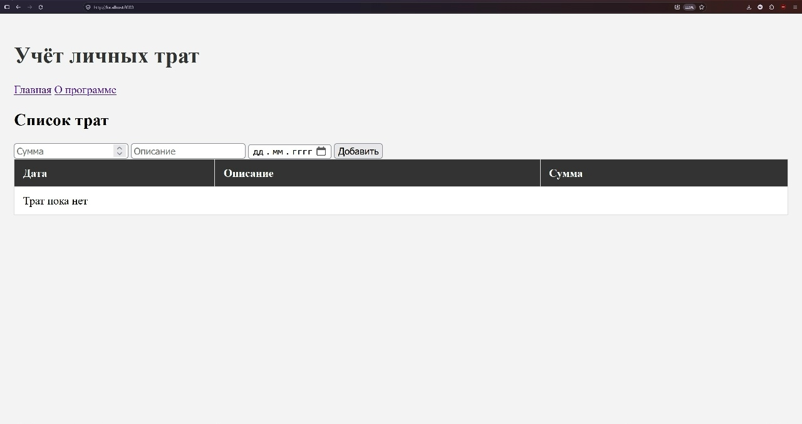
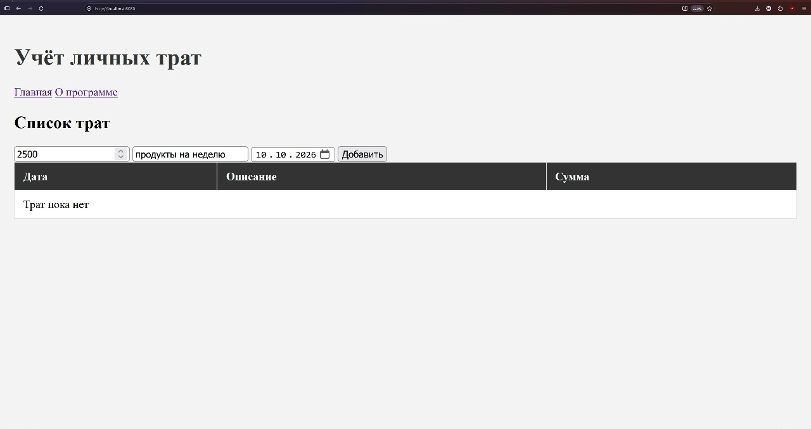
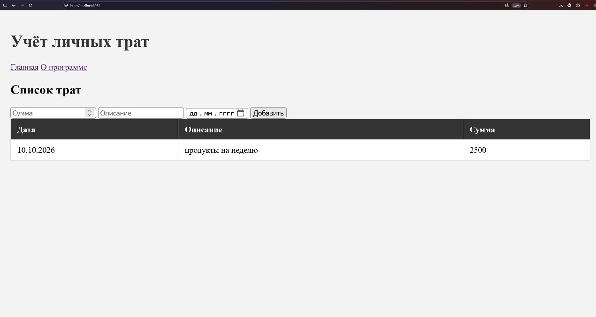
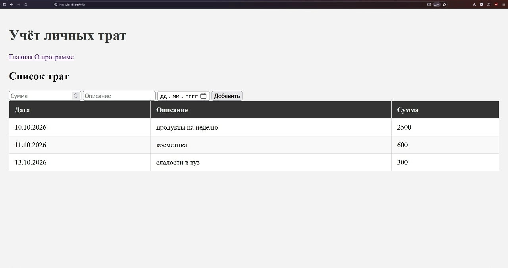

# Учёт личных трат

# Этап 1
## Отчёт: что происходит с запросом от начала до конца

В качестве примера возьмём запрос на `http://localhost:8080/ping`.

**1. Запуск сервера**
Команда `http.ListenAndServe(":8080", nil)` запускает сервер на порту `8080`. Сервер слушает все входящие на него запросы.

Предположим, что запрос `ping` не технологический, а крайне необходимый пользователю.

**2. Браузер отправляет запрос.**
Пользователь с браузера нажимает на кнопку `Проверить доступность сервера`. Запрос `GET http://localhost:8080/ping`с браузера отправляется на сервер.

**3. Сервер принимает запрос.**
Запущенный на Go сервер, слушая входящие запросы, получает наш `/ping`.

**4. Выбирается обработчик (функция-маршрут).**
Полученный запрос обрабатывается 'хендлером' - специальным модулем, который по адресу и типу запроса отправляет данные на нужную функцию-обработчик:

- если путь `/` → идет вызов функции `handler`
- если путь `/about` → идет вызов функции `abouthandler`
- если путь `/ping` → идет вызов функции `pinghandler`

При этом /ping проверяет запрос на метод `GET`, при невыполнении вызывается `405 - Method Not Allowed`

**5. Работа функции-обработчика.**
Функция-обработчик (в нашем случае pinghandler) получает запрос и обрабатывает его:
    Если метод - `GET`, то функция возвращает `200 Status OK`, иначе `405 - Method Not Allowed`

Заметим, что во все функции-обработчики передаются два аргумента:
- `w http.ResponseWriter` - поток общения с пользователем. Туда передаются все данные (данные из БД, стили и разметка html страниц и т.п.)
- `r *http.Request` - структура, содержащая информацию о запросе: Метод (GET/POST/PUT/...), путь, заголовки, данные в теле и т.д.

**6. Сервер отправляет ответ обратно.**
Возвращенное функцией-обработчиком идет в браузер и отображается пользователю как статус ответа.

# Этап 2 
## Фото работы программы

- Вненший вид сайта при первом обращении

- Пример ввода данных расхода

- Пример добавленного расхода

- Пример рабочего вида программы
